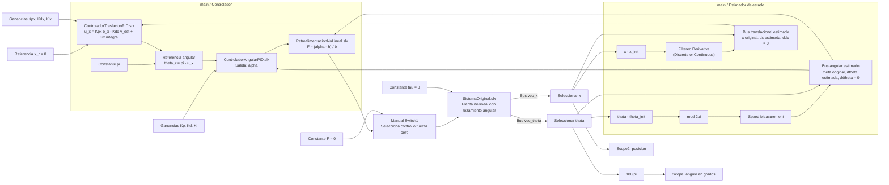

# Contexto del proyecto: péndulo invertido educativo

Actualizado el **30 de octubre de 2026**. Nombre del archivo conservado según lo solicitado: `Resumem.md`.

Este documento resume la conversación y la inspección de los archivos guardados. Sirve para retomar el proyecto en otra conversación. **El sistema completo en cascada todavía no está validado como estable ni listo para hardware.** Los resultados históricos corresponden a versiones anteriores del modelo; no deben atribuirse automáticamente a la versión actual.

## 1. Objetivo y preferencias del usuario

- Construir una maqueta educativa de péndulo invertido sobre un carrito.
- Elaborar un informe auxiliar con modelado mediante Lagrange, compensación no lineal y cálculo de ganancias PD/PID por asignación de polos.
- Mantener la **planta no lineal**, sin sustituirla por una planta linealizada. Se discutió usar aproximaciones lineales para análisis y diseño local, distinguiéndolas del modelo físico simulado.
- El contenido principal para los alumnos debe ser calcular ganancias. La compensación no lineal, los estimadores y eventualmente el controlador de posición pueden entregarse como una caja negra.
- Preferencia por bloques estándar de Simulink para estimar velocidades, evitando implementar estimadores propios cuando haya alternativas adecuadas.
- Interés en generar C/C++ para la MPU que controle la maqueta.
- Los ensayos parten de una desviación respecto de la vertical superior y velocidad nula. El levantamiento desde abajo (*swing-up*) se descartó como objetivo del ejercicio inicial.
- Inicialmente se consideró dejar libre el carrito con supervisión de recorrido. Después se incorporó una cascada de posición y ángulo. Esa cascada está en desarrollo.

## 2. Archivos y entorno

Repositorio: `C:/Users/fedeb/Documents/GitHub/05_Sistemas_de_Automatizacion`.

| Archivo, dentro de `Pendulo Invertido/` | Función |
|---|---|
| `Pendulo_Invertido.m` | Apunte en formato MATLAB Live Code de texto y sección ejecutable de parámetros |
| `main.slx` | Modelo principal: planta, estimadores, cascada, selector de fuerza y Scopes |
| `SistemaOriginal.slx` | Subsistema referenciado con dinámica no lineal del carrito y péndulo |
| `RetroalimentacionNoLineal.slx` | Conversión de aceleración virtual angular a fuerza |
| `ControladorAngularPID.slx` | Control angular manual con bloques básicos |
| `ControladorTraslacionPID.slx` | Control exterior de posición, cuya salida es `ux` |
| `comparacion_rozamiento.png` | Resultado histórico de pruebas de movimiento libre con distintos rozamientos |

El controlador angular tuvo anteriormente el nombre `ControladorPID.slx`; no asumir que sigue siendo la dependencia actual.

MATLAB R2026a presentó problemas de licencia. **R2026b permitió ejecutar las simulaciones**. Desde el entorno restringido hubo problemas de permisos y de identificación de licencia; las ejecuciones satisfactorias se hicieron con acceso ampliado. Los archivos temporales de una ejecución no siempre fueron visibles desde otra: utilizar rutas absolutas persistentes para scripts auxiliares.

El modelo estuvo configurado en Rapid Accelerator, que exigía un compilador C/C++ no disponible. Se simularon versiones anteriores usando `SimulationMode='normal'`, sin necesidad de cambiar permanentemente ese ajuste. Comprobar la configuración actual antes de repetir pruebas.

## 3. Convención física y ecuaciones

- `x`: posición horizontal del carrito.
- `theta`: ángulo respecto de la **vertical descendente**.
- `theta = 0`: equilibrio inferior estable sin control.
- `theta = pi` o `-pi`: equilibrio superior inestable; ambos representan la misma orientación física.
- `l`: distancia del pivote al centro de masa del péndulo.
- `I` o `I2`: inercia del péndulo respecto de su centro de masa, no respecto del pivote.
- `F`: fuerza horizontal sobre el carrito; `tau`: torque externo en el pivote.

Posición del centro de masa:

$$
x_2=x+l\sin\theta,\qquad y_2=-l\cos\theta.
$$

Abreviaturas utilizadas:

$$
M=m_1+m_2,\qquad k=m_2l,\qquad J=m_2l^2+I.
$$

Ecuaciones con rozamiento viscoso angular y, como extensión, rozamiento del carrito:

$$
M\ddot x+k\cos\theta\,\ddot\theta-k\sin\theta\,\dot\theta^2+c_x\dot x=F,
$$

$$
k\cos\theta\,\ddot x+J\ddot\theta+c_\theta\dot\theta+kg\sin\theta=\tau.
$$

La planta inspeccionada incorpora `c_theta`; no se identificó una rama de rozamiento translacional `c_x`.

La disipación puede justificarse en Lagrange mediante:

$$
\mathcal R=\tfrac12c_x\dot x^2+\tfrac12c_\theta\dot\theta^2,
\qquad
\dot E=F\dot x+\tau\dot\theta-c_x\dot x^2-c_\theta\dot\theta^2.
$$

El término viscoso angular es `c_theta*dtheta` en la ecuación acoplada. El factor `M*c_theta*dtheta` aparece solamente al eliminar la aceleración del carrito. No confundir ambas expresiones.

Correcciones realizadas durante la conversación: faltaba el cuadrado de la velocidad en una energía cinética inicial, había `dot(v)^2` donde correspondía `v^2`, y se aclaró el origen de la inercia para evitar contar dos veces el teorema de ejes paralelos.

## 4. Compensación no lineal y PID angular

Para `tau=0` y `c_x=0`, la dinámica angular exacta puede escribirse como:

$$
\ddot\theta=h_c(\theta,\dot\theta)+b(\theta)F,
$$

$$
h_c=\frac{k^2\cos\theta\sin\theta\,\dot\theta^2+Mkg\sin\theta+Mc_\theta\dot\theta}{k^2\cos^2\theta-MJ},
\qquad
b=\frac{k\cos\theta}{k^2\cos^2\theta-MJ}.
$$

La ley propuesta es:

$$
F=\frac{\alpha-h_c}{b}.
$$

Con modelo exacto y fuerza realizable produce `ddtheta = alpha`. **Alpha es una señal interna de aceleración, no la consigna que fija el usuario.** La consigna sigue siendo una posición angular.

Esta técnica se llama linealización por realimentación de entrada-salida, parcial en este sistema subactuado. No aproxima senos o cosenos; compensa términos del modelo. No estabiliza automáticamente los estados del carrito.

**Límite esencial:** cuando `cos(theta)=0`, `b=0` y la inversión no está definida. No sirve como controlador global de levantamiento. No basta con reducir el paso del solver ni reemplazar arbitrariamente el denominador por un número pequeño.

### Ley efectivamente implementada en el controlador angular

$$
e_\theta=\theta_r-\theta,\qquad \dot z_\theta=e_\theta,
$$

$$
\alpha=K_{P\theta}e_\theta-K_{D\theta}\widehat{\dot\theta}+K_{I\theta}z_\theta.
$$

Es una estructura con derivada sobre la medición, integrador continuo y ganancias externas. La aceleración del bus se termina y no se utiliza. No se identificaron saturación ni anti-windup dentro de ese subsistema.

Para referencia constante y compensación exacta:

$$
\ddot e_\theta+K_D\dot e_\theta+K_Pe_\theta+K_Iz_\theta=0.
$$

Para referencias variables, la ecuación anterior no se conserva automáticamente. La ley ideal discutida para seguimiento sería:

$$
\alpha=\ddot\theta_r+K_D(\dot\theta_r-\dot\theta)+K_P(\theta_r-\theta)+K_Iz_\theta.
$$

**Esta anticipación de referencia no está implementada en el controlador angular inspeccionado.** Tampoco garantiza por sí sola estabilidad de la cascada completa.

### Ganancias y espacio de estados del error

PD:

$$
K_P=\omega_n^2,\qquad K_D=2\zeta\omega_n,
\qquad
A_{PD}=\begin{bmatrix}0&1\\-K_P&-K_D\end{bmatrix}.
$$

Estabilidad angular ideal: `Kp>0`, `Kd>0`. Con perturbación angular equivalente constante `d0`, definida por `ddtheta=alpha+d0`, el PD deja `e_eq=-d0/Kp`.

PID, con estados `[e, de, z]`:

$$
A_{PID}=\begin{bmatrix}0&1&0\\-K_P&-K_D&-K_I\\1&0&0\end{bmatrix},
\qquad P(s)=s^3+K_Ds^2+K_Ps+K_I.
$$

Condiciones de estabilidad:

$$
K_P>0,\quad K_D>0,\quad K_I>0,\quad K_DK_P>K_I.
$$

Asignando `P(s)=(s+p)(s^2+2*zeta*omega_n*s+omega_n^2)`:

$$
K_D=2\zeta\omega_n+p,\quad
K_P=\omega_n^2+2p\zeta\omega_n,\quad
K_I=p\omega_n^2.
$$

La integral permite rechazar una perturbación equivalente constante si el sistema de error es estable y no se impide la acción requerida. No elimina automáticamente toda incertidumbre física.

## 5. Diagrama de la implementación guardada

Diagrama funcional obtenido al inspeccionar los `.slx` el 30/10/2026. Los estimadores reciben posiciones de la planta simulada; todavía no son mediciones de hardware.



Los ceros de aceleración en los buses estimados son relleno de interfaz; no significan que la planta no acelere.

Existe además una rama `Scope1` para la diferencia de velocidades angulares. En la versión actual inspeccionada, los selectores que alimentan esa diferencia no tienen entradas conectadas en el nivel superior: revisar antes de interpretarla como validación del estimador.

No se identificaron en el trayecto principal límites de fuerza, límites de referencia angular, finales de carrera ni lógica de parada. El diagrama muestra la compensación como `h`, sin afirmar que ya incorpore `h_c`: **el subsistema inspeccionado no presenta una rama explícita con `c_theta`; debe verificarse y actualizarse su correspondencia con la planta.**

## 6. Parámetros actuales guardados (no equivalen al Workspace de una sesión abierta)

En `Pendulo_Invertido.m`:

```matlab
dx_init = 0;
dtheta_init = 0;
x_init = 0;
theta_init = pi - 20*pi/180; % 160 grados
m1 = 1; m2 = 1; I = 1; l = 1;
c_theta = 1;
M = m1+m2;
J = m2*l*l+I;
k = m2*l;
g = 9.80665;
omega_x = 6;
zeta_x = 0.9;
Kpx = omega_x^2/g;
Kdx = 2*zeta_x*omega_x/g;
Kix = 0;
```

En los bloques de ganancias angulares de `main.slx`: `Kp=2`, `Kd=1.2`, `Ki=0`. Actualmente son controladores PD por tener las integrales anuladas mediante sus ganancias.

Los valores anteriores **no están certificados como estables en cascada**. En versiones previas `omega_x` fue 15 y luego 3.75. No reutilizar resultados de esas versiones como prueba de la configuración con 6.

Editar el script no actualiza el Workspace hasta ejecutarlo. Ejecutarlo después de cambiar una variable manualmente vuelve a sobrescribirla.

## 7. Estimación de velocidades

### Angular

- Bloque estándar `Speed Measurement` de Motor Control Blockset.
- Configuración histórica inspeccionada: radianes, salida rad/s, muestreo `100e-6`, ventana de 299 muestras (~29.9 ms), salida `single`.
- Se comprobó un pico de inicialización: con `theta_init=160 grados` y velocidad real cero, estimaba `93.3953 rad/s`, coincidente con `theta_init/(299*Ts)`.
- Ese error produjo una fuerza inicial de aproximadamente `-12780 N`. El péndulo cruzó la horizontal y se solicitaron fuerzas del orden de `10^15 N`.
- Al realimentar la velocidad real de la planta, la fuerza inicial fue ~18.72 N y el ángulo evolucionó suavemente de 160 a ~161.9 grados en 0.3 s.
- Solución propuesta e incorporada posteriormente por el usuario: alimentar el estimador con `mod(theta-theta_init,2*pi)` y conservar el ángulo absoluto para el controlador. En hardware, capturar la primera lectura y mantenerla como referencia del estimador durante el ensayo.
- La corrección del origen no elimina el retardo ni la cuantización. Falta una validación completa, incluyendo cruces de vuelta y el arranque corregido.

### Translacional

- Bloque actual: `Filtered Derivative (Discrete or Continuous)`, biblioteca Simscape Electrical / Control / General Control.
- Entrada actual: `x-x_init`; el bus conserva `x` absoluto.
- Forma continua: `V_est(s)/X(s)=K*s/(T*s+1)`, con `K=1` para convertir metros en m/s.
- Puede configurarse discreto. El tiempo de muestreo y la constante de filtrado deben elegirse para la implementación y validar ruido/retardo.
- Se discutió como alternativa `Discrete Derivative` de Simulink básico, que no filtra por sí solo.
- No aplicar módulo angular a una posición en metros. No se necesita un sensor separado de velocidad si la posición tiene resolución y adquisición suficientes.

## 8. Control del carrito: decisiones y límites de las aproximaciones

Regular solo el ángulo no controla el recorrido: con el péndulo vertical y fuerza nula, un carrito ideal puede conservar velocidad y desplazarse indefinidamente.

Para una cascada se definió:

$$
u_x=K_{Px}(x_r-x)-K_{Dx}\widehat{\dot x}+K_{Ix}\int(x_r-x)dt,
\qquad \theta_r=\pi-u_x.
$$

La salida exterior es una corrección, no una referencia angular absoluta. La constante `xr=0` no debe cambiarse a `pi`: tienen unidades distintas.

Se propusieron como aproximación inicial para un lazo exterior lento:

$$
\ddot x\approx-g(\theta-\pi),\qquad
K_{Px}=\omega_x^2/g,\quad K_{Dx}=2\zeta_x\omega_x/g.
$$

**Advertencia central:** estas fórmulas no asignan los polos exactos de la cascada. Desprecian la dinámica angular y sus derivadas. La estabilidad del sistema completo, con estimadores y límites, sigue pendiente. No presentar estas ganancias como garantía de estabilidad.

El usuario propuso `omega_x=500`, `zeta_x=1.1`: dan `Kpx≈25492.91 rad/m`, `Kdx≈112.17 rad*s/m`; 1 mm de error pediría ~25.49 rad de inclinación. Se desaconsejó utilizarlas. Hacer más rápido el lazo exterior no desacopla el péndulo: es distinto de disponer de un lazo interior rápido de corriente o aceleración del accionamiento.

Propuesta docente: entregar control exterior fijo y validado para un rango de ganancias angulares. Permitir ganancias angulares arbitrarias puede invalidar la cascada. Distinguir estabilidad local, cumplimiento de límites y regulación durante un ensayo finito.

Con un solo actuador no se pueden imponer trayectorias arbitrarias independientes de `x` y `theta`. Para acelerar o frenar el carrito debe permitirse una desviación angular transitoria. Si se acciona también el pivote se convierte en un sistema de dos entradas y cambia el ejercicio.

## 9. Diagnósticos y cambios realizados durante la conversación

### Formato del apunte

Se corrigieron delimitadores LaTeX, expresiones fuera de modo matemático, un dólar suelto y bloques `align` adaptados a `array`. En el formato Live Code `%[text]`, las barras dobles de comandos y escapes Markdown son parte del almacenamiento: no eliminarlos masivamente como si fueran errores de LaTeX ordinario. La exportación visual intentada entonces no pudo validarse por la licencia de R2026a.

### Planta y rozamiento

Se corrigieron en `SistemaOriginal.slx`:

1. Ganancia de rozamiento `c_theta*M` a `c_theta` en la ecuación acoplada.
2. Término centrífugo que recibía `theta` en vez de `dtheta^2`; se conectó el cuadrado de la velocidad angular.

Pruebas históricas, sin control y desde 45 grados: `c_theta=0` dio oscilaciones sostenidas; 1 y 4 dieron amortiguamiento oscilatorio; 10 dio retorno sin oscilaciones. Una respuesta monótona no demuestra que la planta sea de primer orden. La envolvente exponencial es una descripción local, no una exigencia exacta para grandes oscilaciones no lineales.

### Scope

Se encontró límite de 20.000 muestras con una simulación de 90 s y paso máximo de 1 ms; se obtuvieron 90.004 muestras. El Scope descartaba el transitorio. Se desactivó `DataLoggingLimitDataPoints` y se guardó `main.slx`; la prueba de esa versión terminó correctamente. Reabrir el archivo si una sesión conserva ajustes anteriores.

### Selector de fuerza y referencia angular

- Se encontró que la salida `ux` llegaba directamente al PID angular. El usuario corrigió a `theta_r=pi-ux`; esa conexión está presente actualmente.
- Posteriormente se comprobó que `Manual Switch1` seleccionaba fuerza cero: durante 20 s, `F_aplicada=0` aunque `F_control` fuera no nula. El ángulo final fue ~-0.215 grados: caída libre amortiguada, no regulación fallida a una referencia cero.
- Inspeccionar siempre **la fuerza aplicada después del selector**, no solo la salida del controlador. No asumir que el selector actual conserva la posición de una prueba histórica.
- En una versión anterior `Kp=2`, `Kd=1.2`, `Ki=6` incumplía `Kd*Kp>Ki`. Actualmente `Ki=0`; no repetir esa observación antigua como diagnóstico actual.

### Último error de simulación pendiente

El usuario informó:

```text
Unable to solve the algebraic loop that contains block
'main/Subsystem Reference/Sum3'
at time 26.239355097492233 using the TrustRegion-based algorithm.
```

Se inició un diagnóstico registrando `theta`, `theta_r`, fuerza solicitada, fuerza aplicada y `x`, pero **la conversación no contiene un resultado concluyente de esa ejecución**. No afirmar que la causa de ese fallo particular quedó confirmada.

Dos asuntos a distinguir:

- La planta implementa las aceleraciones implícitas mediante un lazo algebraico. Puede reformularse resolviendo explícitamente el sistema de masa, sin cambiar la física ni agregar retardos artificiales.
- La compensación contiene `1/cos(theta)` y sí puede volverse singular al pasar por la horizontal. Una cascada inestable puede llevarla allí. Reducir tolerancias no soluciona una singularidad del controlador.

Con los parámetros nominales, el determinante de la matriz de masa es `MJ-k^2*cos(theta)^2=4-cos(theta)^2`, siempre mayor o igual que 3. No confundir esa matriz invertible de la planta con la singularidad de la compensación de entrada-salida.

## 10. Ejercicios propuestos

Se plantearon cuatro ejercicios: PD y PID con especificaciones definidas; PD y PID con fuerza limitada y minimización del tiempo de establecimiento bajo un sobrepaso máximo.

- Ejemplo didáctico inicial: desviación de 5 grados desde arriba, velocidad nula; sobrepaso máximo 5%, establecimiento al 2% en hasta 2 s.
- Para PD ideal: `zeta≈0.690`, `omega_n≈2.90`, `Kp≈8.40`, `Kd≈4.00`. Son valores iniciales; la fórmula `ts≈4/(zeta*omega_n)` es aproximada.
- Para PID, el tercer polo y el numerador de la respuesta impiden aplicar sin más las fórmulas de sobrepaso del segundo orden.
- “Minimizar simultáneamente sobrepaso y tiempo” no define una solución única: fijar uno como restricción o definir un criterio de optimización.
- Verificar fuerza, recorrido y tiempo de ensayo. Si se permite saturación, incluirla y tratar el windup.
- Preparación física: sostener el péndulo a la inclinación inicial, centrar el carrito, reiniciar integradores y sincronizar liberación/activación sin impulso apreciable.

## 11. Hardware y generación de código

Hardware previsto, todavía incompleto:

- Motor DC desconocido que mueve el carrito por piñón y cremallera.
- Motor a incorporar en el pivote, con encoder, para colocar el ángulo inicial y medir posición angular.
- MPU, driver, resolución de encoders, recorrido y fuerza máxima aún por definir.

Un motor conectado al pivote no es solamente un sensor: agrega inercia, rozamiento y posibles torques. Debe decidirse si se desacopla tras preparar el ensayo o se modela su efecto. Apagarlo no garantiza torque nulo; mantenerlo regulando agrega un segundo actuador.

Para medir `x`, opciones discutidas: encoder en el piñón, encoder en el motor considerando reducción, encoder lineal o potenciómetro lineal. Con radio primitivo `rp` y giro del piñón `phi`, `x=x0+rp*(phi-phi0)`. Considerar holguras, referencia inicial y conteos efectivos; resolución no equivale a precisión. El usuario pospuso la selección de sensores.

La fuerza no equivale al PWM. Como aproximación de motor DC de imanes permanentes, `tau_m=Kt*i` y `F≈eta*N*Kt*i/rp`, sin incluir toda la dinámica de transmisión. Hace falta identificar el motor y su accionamiento.

Se necesitan límites de operación interiores a los topes, medición de posición/velocidad y finales de carrera. Fuerza cero no equivale a frenado. Reservar distancia para desaceleración, retardo y margen. Una parada puede sacrificar el equilibrio angular.

Simulink Coder puede generar C/C++; Embedded Coder agrega opciones para integración embebida. Generar el controlador, estimadores y lógica auxiliar; la planta real reemplaza al modelo simulado. Definir muestreo, integración discreta, interfaces encoder/ADC/PWM, límites y pruebas antes de desplegar.

El PID manual también puede generar código; no es obligatorio cambiarlo por el bloque estándar. El estándar aporta filtrado, reinicio y anti-windup. Para equivalencia deben coincidir forma paralela, derivada sobre medición, señales externas, estados e integración. Una estructura 2DOF con ponderaciones `b=1,c=0` reproduce el reparto P/I sobre error y D sobre medición, sujeto a configuración del filtro.

La saturación física está después de la compensación, en fuerza. No poner `±Fmax` como límites de un PID cuya salida está en aceleración angular. El anti-windup debe reflejar la acción efectivamente realizable.

## 12. Próximos pasos para retomar

1. Releer los archivos y parámetros actuales: el usuario continúa editándolos y el Workspace puede diferir del disco.
2. Reproducir el fallo del lazo algebraico; registrar señales antes del fallo y el mínimo de `abs(cos(theta))`.
3. Auditar `RetroalimentacionNoLineal.slx`: signos, operadores trigonométricos y ausencia/presencia del término viscoso correcto.
4. Validar separadamente la planta y el lazo angular con referencia fija, usando primero estados reales y luego estimadores.
5. Verificar inicialización, unidades, muestreo, retardo y cuantización de ambos estimadores.
6. Diseñar y analizar la cascada completa; no seguir eligiendo `omega_x` con la aproximación lenta como si garantizara estabilidad.
7. Incorporar límites de referencia angular, fuerza y supervisión de recorrido con parámetros físicos definidos.
8. Mantener el cálculo de ganancias de los alumnos separado de las validaciones docentes de la caja negra.
9. Definir motor, driver, MPU, encoders y mecanismo de liberación antes de generar software de hardware definitivo.

## 13. Referencias utilizadas

- [MIT: cart-pole y linealización parcial por realimentación](https://underactuated.mit.edu/acrobot.html)
- [MathWorks: formato Live Code](https://www.mathworks.com/help/matlab/matlab_prog/file-format-for-live-scripts.html)
- [Scope](https://www.mathworks.com/help/simulink/slref/scope.html)
- [Speed Measurement](https://www.mathworks.com/help/mcb/ref/speedmeasurement.html)
- [Filtered Derivative](https://www.mathworks.com/help/simscape-electrical/ref/filteredderivativediscreteorcontinuous.html)
- [PID Controller](https://www.mathworks.com/help/simulink/slref/pidcontroller.html)
- [PID de dos grados de libertad](https://www.mathworks.com/help/control/ug/two-degree-of-freedom-2-dof-pid-controllers.html)
- [Simulink Coder](https://www.mathworks.com/products/simulink-coder.html)

**Para una nueva conversación:** leer este documento y los modelos actuales. No tratar las ganancias guardadas, la cascada o el último fallo como asuntos ya resueltos. Las pruebas históricas validaron partes concretas, no la maqueta completa.
